# KDH Marketing Reporting Platform — kiến trúc

Cập nhật 10/10/2026 từ code local của hai repository. Điểm bàn giao: [KDH_HANDOVER.md](KDH_HANDOVER.md).

## Quyền sở hữu

| Thành phần | Trách nhiệm | Không thực hiện |
| --- | --- | --- |
| Admin — Flask, Vanilla JS | Người dùng, kết nối provider, sync, PostgreSQL, Dataset, review, release, Bundle, quyền xem | Không giao token provider cho New |
| Worker Admin | Gọi adapter, lưu dữ liệu và truy vết, lịch chạy | Không xác nhận nguồn chỉ bằng `succeeded` |
| New — FastAPI, Jinja2, Vanilla JS | Đăng nhập người xem qua Admin, đọc Bundle qua HTTP, ánh xạ và hiển thị | Không đọc PostgreSQL Admin; không gọi provider để làm mới báo cáo |

```mermaid
flowchart LR
  P[Provider được cấp quyền] --> A[Adapter và Sync trong Admin]
  A --> S[Source snapshot + daily_metrics + receipt]
  S --> D[Marketing Dataset bất biến]
  D --> R[Duyệt nội bộ và Release Candidate]
  R --> V[Kiểm tra nguồn và duyệt phát hành]
  V --> F[Release Snapshot có seal]
  F --> B[Report Bundle revision đã xuất bản]
  B -->|Internal API + service token + phiên người xem| N[Backend New]
  N --> U[Dashboard khách hàng]
```

UI hiện dành cho một khách hàng KinderHealth; `client_id` vẫn được kiểm tra trong storage, Dataset, Bundle và grants. Không phải một hệ thống multi-tenant có giao diện quản lý tenant hoàn chỉnh.

## Các lớp chính

- `metric_catalog`, `metric_reader`, `metric_snapshot`, `metric_calculator`: định nghĩa và đọc KPI đúng phạm vi. Google period totals được ưu tiên để không cộng sai unique users, tỷ lệ và vị trí.
- `evidence_engine`, `opportunity_engine`, `marketing_preview`: bằng chứng và đề xuất dựa trên quy tắc. Preview không phải kết luận đã xác minh.
- `marketing_dataset`, `marketing_review`, `marketing_release`: chụp nội dung, ghi review gắn hash, tạo Candidate riêng.
- `marketing_provenance`, `marketing_source_check`, `marketing_approval`, `marketing_publication`: nguồn kỹ thuật, phê duyệt phát hành và snapshot được phép đưa vào Bundle.
- `report_bundles`, `report_bundle_routes`: quản lý draft, provisional, final và revision. Giữ contract 1.0 và luồng báo cáo cũ.
- `viewer_access`: quyền theo báo cáo/revision, kiểm tra lại session/user và quyền loại báo cáo trên mỗi request.
- `marketing_console`, `templates/marketing.html`, `static/marketing.js`: giao diện `/marketing` để vận hành chuỗi duyệt.
- New `AdminViewerRepository → BundleService → BundleViewMapper → templates/pages/published`: chỉ hiển thị dữ liệu backend cho phép.

## Lưu trữ và migrations

PostgreSQL 16 trong Docker là runtime chính. SQLite được giữ cho local/test và tương thích. Migrations chạy tăng dần, có khóa giao dịch; migrations 1–5 được giữ nguyên trong đợt mở rộng này.

| Migration | Nội dung |
| --- | --- |
| 6 — marketing_verified_releases | `source_attestations`, `marketing_release_approvals`, `marketing_release_snapshots` |
| 7 — report_viewer_grants | Quyền user/client/report và khoảng revision |

Dataset và revision đã công bố không có API cập nhật nội dung. Dữ liệu nguồn có thể được đồng bộ lại; không vì vậy mà tái tính hay thay nội dung revision cũ. Receipt và release seal dùng khóa mã hóa của Admin; đây là xác nhận của ứng dụng trong ranh giới backend được tin cậy, không phải chữ ký hay kiểm toán do Google cấp.

## Phạm vi bảo mật hiện có

Tái sử dụng ba vai trò `admin`, `operator`, `viewer`. Review, approval, publication và cấp quyền riêng cho report chỉ Admin. Mọi API ghi từ Admin vẫn yêu cầu session và CSRF. New có cookie phiên riêng, HttpOnly/SameSite, CSRF form, kiểm tra origin và redirect nội bộ. Service token chỉ tồn tại ở hai backend.

Trong production, New không mở các dashboard mock cũ. Preview Marketing đi qua route riêng, bắt buộc phiên Admin và gắn nhãn chưa xác minh/chưa xuất bản. Chức năng Owner, mời user, khôi phục mật khẩu qua email và 2FA không được bổ sung trong đợt Marketing này.
